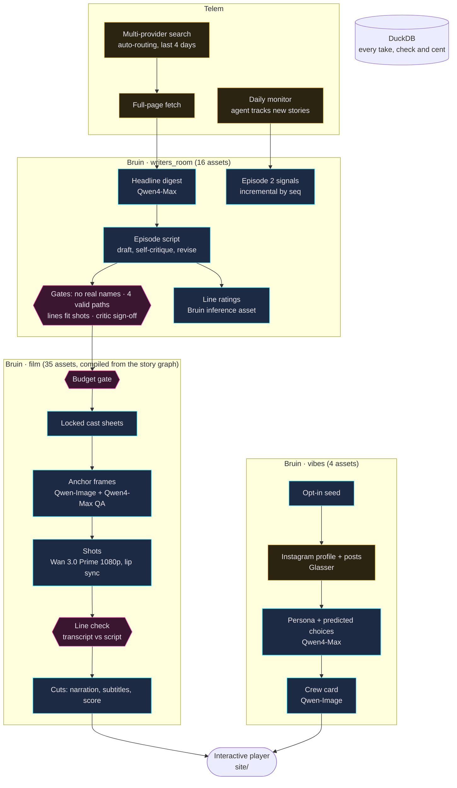
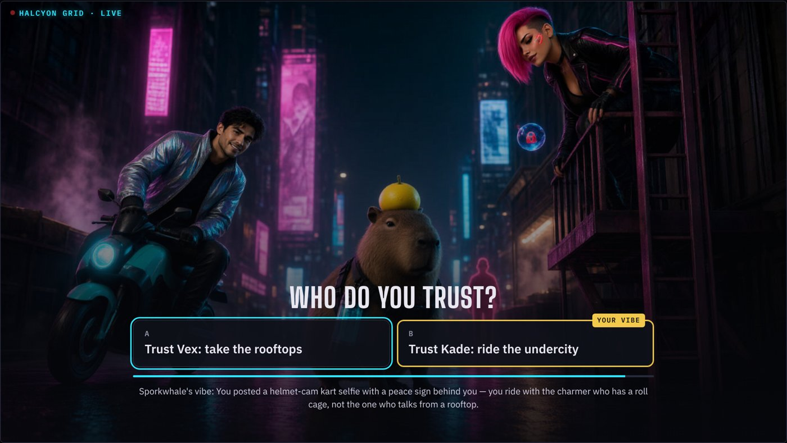
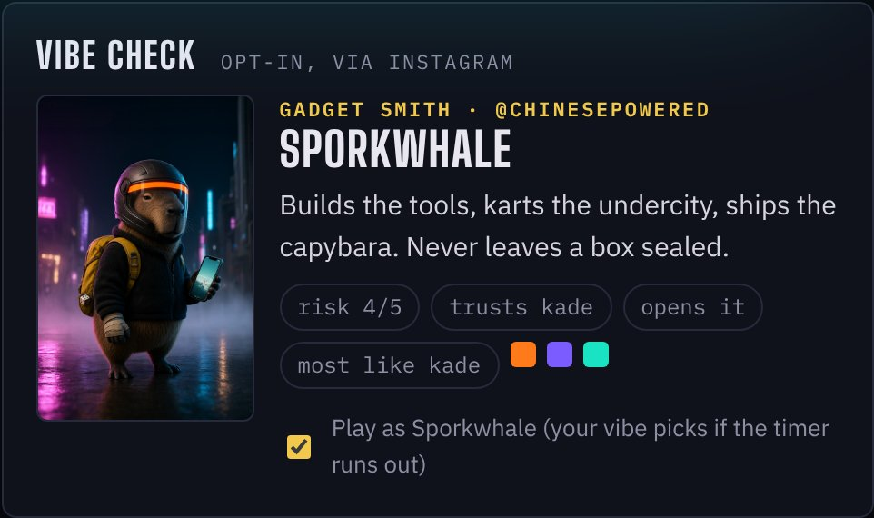
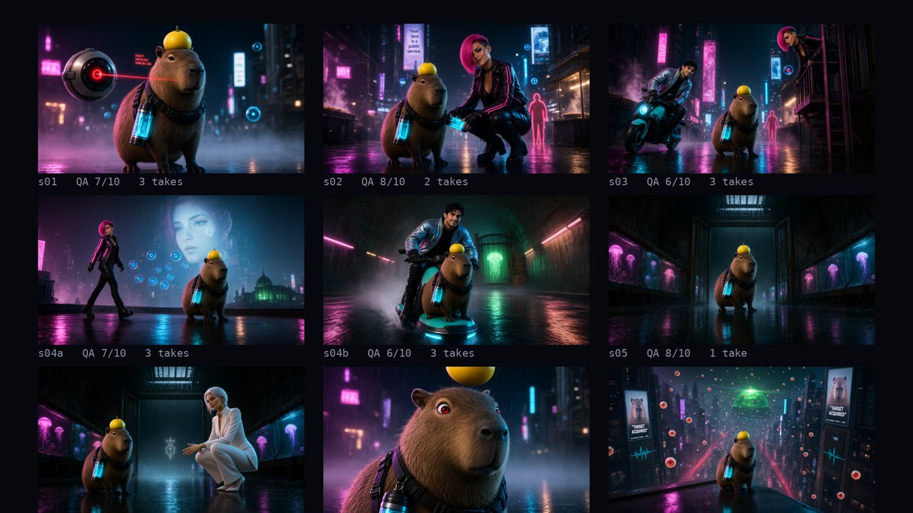
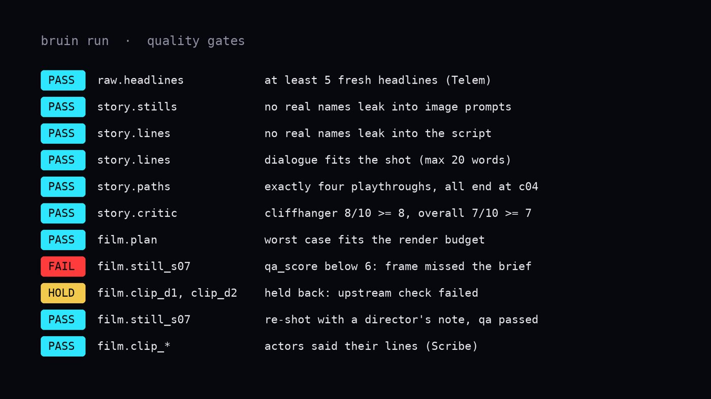
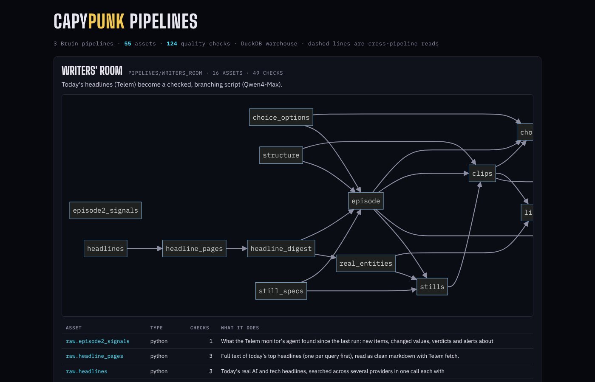
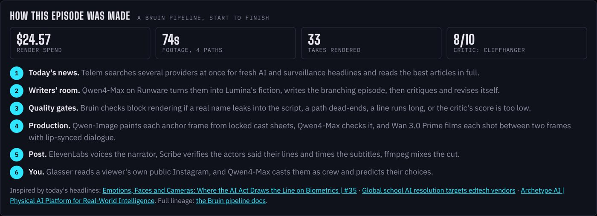

<p align="center"></p>

<h1 align="center">CapyPunk</h1>

<p align="center"><b>An interactive cyberpunk film that writes, shoots, checks and personalizes itself, run as a Bruin data pipeline.</b></p>

<p align="center">
  <a href="https://capypunk.vercel.app"><b>Play the episode</b></a> &nbsp;·&nbsp;
  <a href="demo/capypunk_demo.mp4"><b>Watch the demo (2:25)</b></a> &nbsp;·&nbsp;
  <a href="https://capypunk.vercel.app/pipeline"><b>Explore the pipeline</b></a>
</p>

CapyPunk is a choose-your-own-adventure cyberpunk episode starring Yuzu, a capybara courier so calm that the city's fear-reading AI can't see it. Everything on screen was produced by three Bruin pipelines: a writers' room that turns this week's real AI-surveillance headlines into a branching script, a film pipeline that shoots every branch in 1080p with lip-synced dialogue, and a vibe check that reads a viewer's Instagram to predict which choices they'll make. 124 quality checks gate the expensive steps, so a weak script, a leaked real name or an off-model frame never reaches the screen, and a fluffed line gets an automatic retake. Episode 1 has two choices, four paths and one cliffhanger, and cost $24.57 to render.

## The problem

AI video can now make a beautiful eight-second shot. Making a *story* with it is still chaos: prompts live in scattered notebooks, characters drift from shot to shot, you only learn a render is unusable after you've paid for it, and an interactive story multiplies every render and every failure by its number of branches. Generative media has none of the discipline data teams take for granted: no lineage, no tests, no budgets, no incremental rebuilds.

## Our solution

CapyPunk treats a film like a data pipeline, and runs the whole production on Bruin.

- **The story compiles into a DAG.** The episode's branching structure becomes a Bruin pipeline with one asset per character, anchor frame and shot, wired by continuity. Bruin renders independent shots in parallel and a failure only holds back its own branch.
- **Quality checks are the QA department.** Blocking checks stop a script the critic scores too low, a real company name leaking into the fiction, or an off-model frame, before money is spent downstream. A shot whose actors miss their lines is retaken automatically.
- **Everything is data.** Every take, QA verdict, transcript and cent lands in DuckDB, so the player's "how it was made" panel is a query, and spend is audited against a budget gate.
- **Fix one thing, re-render one thing.** When one frame missed its brief, Bruin held back exactly the two shots that depend on it until it was re-shot.
- **The story keeps up with the news.** A Telem monitor feeds the next episode's plot incrementally, straight into the warehouse.

## Sponsors at a glance

| Sponsor | What it does in CapyPunk | Highlights |
|---|---|---|
| **Bruin** | Runs the entire production: 3 pipelines, 55 assets, 124 checks | DAG compiled from the story graph · checks as creative gates · native inference asset · upstream patch with tests |
| **Telem** | Finds the real news that becomes the plot, and watches for the next episode | Multi-provider search with auto-routing · full-page fetch · monitor read incrementally by cursor |
| **Runware** | Every model call, all Alibaba | Qwen4-Max writes, critiques and judges · Qwen-Image 2.1 Turbo paints consistent frames · Wan 3.0 Prime shoots 1080p branches with lip sync |
| **Glasser** | Opt-in personalization from a viewer's own Instagram | Profile and posts for about $0.001 per viewer · every Run's charge and URL kept in the warehouse |
| **HarnessRouter** | CapyPunk Studio: anyone's premise becomes a playable skit | Qwen4-Max on the `hermes` base · signed sandboxed previews · follow-up revisions |

## Architecture



## Sponsor deep dives

### Bruin: the studio is a Bruin project

Every step from headline to final cut is a Bruin asset in one of three pipelines on a local DuckDB warehouse, and the checks between them are what make an AI-generated film trustworthy.

**Every asset type we needed.** Python assets call the APIs (`raw.headlines`, `film.clip_c01`), SQL assets shape the script (`story.lines` explodes the script JSON, `story.paths` walks the story graph with a recursive CTE), a seed asset holds viewer consent (`vibes.viewers`), and a native inference asset gives every line of dialogue typed, validated columns (`story.line_ratings`).

**The story compiles into the pipeline.** [`scripts/compile_film.py`](scripts/compile_film.py) reads the series bible's branching structure and writes the 35-asset `film` pipeline: a still depends on the cast in it and the frame it continues from, and a shot depends on the two frames it runs between. Bruin renders the eight shots in parallel and isolates failures per branch.

**Quality checks as creative gates.** Each of these blocks everything downstream when it fails, except the line check, which warns after the shoot has already retaken the shot:

| Gate | Asset | What it catches |
|---|---|---|
| No real names in the fiction | `story.stills`, `story.lines` | Any company, product or person named in the source articles (custom SQL join, word-boundary match) |
| A valid story graph | `story.clips`, `story.choices`, `story.paths` | Dangling scene links (`relationships` checks), choices without two options, anything but four paths ending on the cliffhanger |
| Lines fit their shots | `story.lines` | More than 20 words of dialogue in a single shot |
| The critic signs off | `story.critic`, `film.plan` | Hook below 7, cliffhanger below 8, overall below 7 |
| Budget | `film.plan`, `film.spend` | A worst-case render plan over budget; actual spend audited after |
| On-model frames | `film.still_*` | A Qwen4-Max QA score below 6 for the best of three takes |
| The actors said their lines | `film.clip_*` | A speech-to-text transcript matching less than 60% of the script, even after a retake |
| Personalization stays honest and cheap | `vibes.personas`, `vibes.cards` | A predicted path that doesn't exist; more than $0.10 per viewer |

**A gate that actually fired.** The close-up where Yuzu's calm finally breaks (`film.still_s07`) missed its brief three takes running. Its check failed, Bruin held back exactly the two shots that land on it, a director's note went into the bible, and `bruin run` on that one asset re-shot it.

**The warehouse is the production record.** Every take's URL, QA verdict, transcript, dialogue match, render time and charge is a row. `film.spend` audits real cost against `film.plan`'s budget, and the player's "how it was made" panel reads the same tables.

**Incremental and surgical.** `raw.episode2_signals` merges the Telem monitor's changes by `seq`. `--downstream` re-ran only what depended on a change, and `--only checks` re-ran a fixed check without paying for the model call again. Keys come in through generic connections, and render resolution and budget are pipeline variables.

**We improved Bruin.** [`patches/bruin-runware-provider-and-default-secrets.patch`](patches/bruin-runware-provider-and-default-secrets.patch), with tests:
- adds a `runware` provider to inference assets, used live by `story.line_ratings` on Qwen4-Max, including Runware's prompt-cache accounting
- fixes pipeline-level `default.secrets` without `inject_as`, which were silently injected under an empty variable name

We also found that `accepted_values` on a Python asset landing in DuckDB double-quotes its values; it's documented below and worked around with an explicit SQL check.

**Lineage you can browse.** [`site/pipeline.html`](https://capypunk.vercel.app/pipeline) is generated from `bruin internal parse-pipeline`: a graph of each pipeline and every asset with its checks.

### Telem: the news writes the plot

- **Search.** `raw.headlines` runs three searches per episode (new AI models, emotion-recognition surveillance, robotics) with `auto_routing: accuracy` and a four-day `published_after` window, keeping each result's provider. This episode found 54 headlines across five providers.
- **Fetch.** `raw.headline_pages` reads the top five articles in full as clean markdown, with a check that at least three are readable.
- **It shaped the story.** Episode 1's plot came from a legal newsletter on where the EU AI Act draws the line on biometrics: the same emotion-reading camera can be illegal on a clerk and unregulated on a customer. So in Halcyon City, Lumina reclassifies every citizen as a guest, and the first billboard you see reads "Your face is a public service."
- **Monitors feed Episode 2.** A daily monitor watches "new laws, lawsuits or product launches involving AI emotion recognition or biometric surveillance". `raw.episode2_signals` reads its agent's changes from the last `seq` stored in DuckDB, Telem's own cursor pattern. It has logged 17 stories so far, including UK plans for live facial recognition legislation, the NYPD's 26,000 facial recognition searches, and California limiting employers who read workers' emotions.

### Runware: one API, three Alibaba models, every pixel and word

| Model | Jobs in CapyPunk |
|---|---|
| **Qwen4-Max** | Research desk, head writer (draft, self-critique, revise), independent critic, vision QA judge for every frame and sampled shot, line rater (as a Bruin inference asset), and casting director that reads a viewer's captions and photos. Strict JSON-schema output everywhere. |
| **Qwen-Image 2.1 Turbo** | Four locked cast sheets, nine anchor frames kept consistent with multiple references (the cast sheets plus the previous frame), and every viewer's crew card. About $0.014 an image. |
| **Wan 3.0 Prime** | Eight shots at 1080p, each pinned between two anchor frames, so both branches of a choice leave from the exact frame on screen and both endings land on the same close-up. Characters speak their lines with native lip sync: every scripted line was spoken verbatim, verified by transcript. $24.24 for ten takes. |

We also wrote the `runware` provider for Bruin's inference assets (see Bruin above), so any Bruin pipeline can use Runware-hosted models for typed columns.

### Glasser: paid data, on demand, with a paper trail

- **Consent first.** A handle is looked up only if it's in [`pipelines/vibes/assets/viewers.csv`](pipelines/vibes/assets/viewers.csv), a Bruin seed with its own checks.
- **Pay per call, audited.** `vibes.ig_profiles` calls AnyAPI's `/instagram.profile` and `/instagram.user_posts` through Glasser's API for about $0.0013 per viewer, storing each Run's charge and Run URL, with a check capping it at $0.01.
- **What the viewer gets.** Qwen4-Max casts them as Halcyon City crew. The demo account became "Sporkwhale", a Gadget Smith who "never leaves a box sealed", predicted to trust Kade because of a kart helmet-cam selfie. In the player, a "your vibe" badge marks the predicted choice, the timer defaults to it, and the end screen scores how true you played to your vibe.
- **Private by design.** The persona has in-world fields only, so there's nowhere to record guesses about age, ethnicity or anything sensitive, and the crew card is the viewer's own capybara, never their face.

### HarnessRouter: CapyPunk Studio

[`studio/`](studio/README.md) puts the idea behind an agent. Anyone types a premise, and a HarnessRouter agent writes a playable seven-scene skit:
- `index.html`, a self-contained, playable version
- `story.json`, with a cinematic `shot` prompt for every scene, in the shape the film pipeline can render
- a manifest

- **The Harness:** `chrn_53247c83d5284e6a8bb6fc83084a9a3b`, base `hermes`, model `qwen4-max`, with standing instructions written as an output contract ([`studio/instructions.md`](studio/instructions.md)) and per-task budgets.
- **A production-grade integration:**
  - The browser never sees the key or the Harness ID, and every task carries the visitor's own server-issued id as `user`.
  - Tasks run in background mode and are polled.
  - Revisions continue the same session via `previous_response_id` and `session_id`.
  - Generated HTML is shown through HMAC-signed, expiring, CSP-sandboxed preview URLs, and downloads check ownership.
  - `update_harness.py` changes the live Harness safely, fetching it first and updating it with `If-Match`.
- **Verified live:** "a capybara barista whose espresso machine only speaks in haiku" became *Steam & Syllables* in about four minutes, with no broken links, and a second visitor got 404 on every route for it. Five unit tests run against a fake HarnessRouter.


## By the numbers

| | |
|---|---|
| Render spend | **$24.57**: $24.24 for 10 Wan takes across 8 shots, $0.33 for 23 Qwen-Image takes across 9 frames |
| Production | 3 pipelines · 55 assets · 124 quality checks |
| Episode | 2 choices · 4 paths of about a minute · 74 s of footage · 1080p |
| Dialogue | Every scripted line spoken verbatim (transcript match 1.0 on all 7 shots with dialogue) |
| Script | Written in 2 rounds; critic scores: hook 7, cliffhanger 8, overall 7 |
| News | 54 headlines from 5 search providers, 5 read in full, 17 monitor findings for Episode 2 |
| Personalization | About $0.035 per viewer (Glasser + Qwen4-Max + crew card) |

## Gallery

| | |
|---|---|
|  |  |
|  |  |
|  |  |
|  |  |

## Run it

The built episode is a static site in [`site/`](site/): open `site/index.html`, or import the repo into Vercel (the root `vercel.json` serves `site/` with zero config).

To produce an episode yourself you need Python 3.11+, [uv](https://docs.astral.sh/uv/), ffmpeg, a Bruin CLI built with the patch in `patches/`, and the API keys listed in [`scripts/write_bruin_yml.py`](scripts/write_bruin_yml.py), exported as environment variables:

```bash
python3 scripts/write_bruin_yml.py     # turns the exported keys into the gitignored .bruin.yml
bruin run pipelines/writers_room       # today's headlines -> a checked branching script
python3 scripts/compile_film.py        # story graph -> film pipeline
bruin run pipelines/film               # frames, shots, cuts, player (1080p by default)
bruin run pipelines/vibes              # opted-in viewers from pipelines/vibes/assets/viewers.csv
```

In sandboxes that can't download GitHub release assets, add `--debug-ingestr-src "ingestr==1.1.96"` so Bruin installs ingestr from PyPI. Known Bruin quirk: `accepted_values` on a Python asset landing in DuckDB double-quotes its values, so `vibes.personas` uses an explicit SQL check instead.

## Repo map

```
series/          the series bible: world, cast, beat sheet, branching structure; locked cast sheets; monitor id
pipelines/       writers_room · film (compiled) · vibes
lib/capypunk/    API clients, writers' room prompts, production, vibe check, player build
site/            the built, playable episode (static, deploys as-is)
studio/          CapyPunk Studio on HarnessRouter
patches/         our upstream Bruin patch
scripts/         compile_film, lineage_page, screenshots, build_demo, pilot scripts
demo/            the demo video
```
