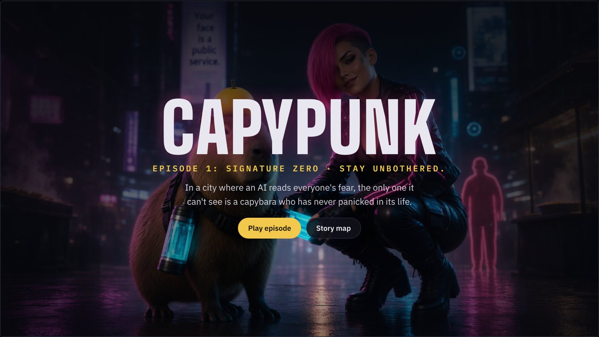
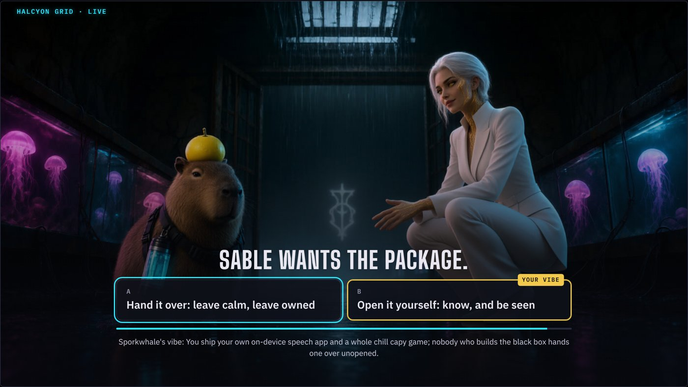
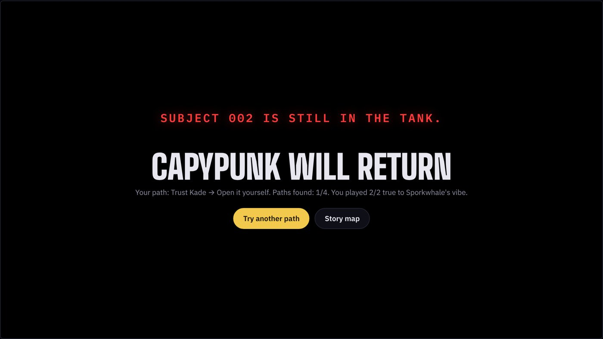
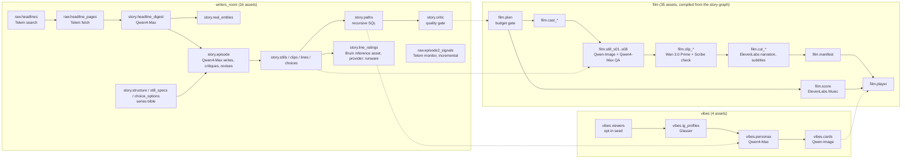

# CapyPunk

**An interactive cyberpunk episode about the one creature a surveillance AI can't see, written, filmed, checked and personalized by Bruin data pipelines.**

In Halcyon City, the megacorp Lumina's Serenity Grid reads every citizen's fear. Panic, and it finds you. The only one it has never seen is Yuzu, a capybara courier with a yuzu on its head and a stress signature of exactly zero. Tonight Yuzu is carrying a glowing canister to the Old Aquarium, two glamorous strangers each say the other is lying, and you decide who to trust.

*Episode 1: Signature Zero* has two decisions, four paths and one cliffhanger. Stay unbothered.

- **Play it:** [CapyPunk on claude.ai](https://claude.ai/artifact/UeooDXhMa1TpFnqs721orX) (the owner shares it from the page's Share menu)
- **Watch the demo:** [`demo/capypunk_demo.mp4`](demo/capypunk_demo.mp4) (2:25)
- **Lineage:** every asset and check, generated from the pipelines (`player/dist/pipeline.html`, published next to the player)

| | |
|---|---|
|  |  |
|  |  |

## How it's made

Three Bruin pipelines, 55 assets and 124 quality checks, all on a local DuckDB warehouse:



1. **Today's news.** `raw.headlines` runs three Telem searches with auto-routing across providers; `raw.headline_pages` reads the best five articles in full with Telem fetch.
2. **Writers' room.** Qwen4-Max (Runware) turns the real story into Lumina's fiction (this episode: EU rules that make emotion-reading cameras illegal on staff but not on customers, so Lumina reclassifies every citizen as a customer), then writes the episode against the series bible's beat sheet and fixed branching structure, critiques its own draft and revises it.
3. **Quality gates.** SQL assets explode the script into stills, clips, lines and choices; checks block rendering if a real name from the source articles leaks into the fiction, a line runs longer than its shot, a choice lacks two options, the story graph has anything but four complete paths, or an independent critic scores the cliffhanger below 8.
4. **The story compiles into a pipeline.** `scripts/compile_film.py` turns the story graph into the `film` pipeline: one asset per cast member, anchor still and clip, wired so a still depends on the cast in it and the frame it continues from, and a clip depends on the two stills it runs between. Bruin renders independent shots in parallel and holds back only the branch behind a failed check.
5. **Production.** Qwen-Image 2.1 Turbo paints every anchor frame from locked cast sheets (`series/cast/`); Qwen4-Max checks each take against the sheets and the brief and keeps the best of up to three. Wan 3.0 Prime films each shot between two anchor frames at 1080p with native, lip-synced dialogue: branches leave from the exact frame where the choice appears, and both endings land on the same close-up.
6. **Post.** ElevenLabs Scribe transcribes every clip to verify the actors said their lines (all eight matched the script exactly) and to time the subtitles. Narration (ElevenLabs, voice "Rick") goes into the nearest gap in the dialogue; when no gap is long enough, the shot holds on its first frame while the narrator speaks. ElevenLabs Music scores the episode.
7. **You.** A viewer who opts in gives their own Instagram handle; Glasser fetches the public profile and posts, Qwen4-Max casts them as a crew member with typed in-world fields and predicts their two choices, and Qwen-Image paints their crew card as their own capybara. In the player, a "your vibe" badge marks the predicted option, and if the timer runs out your vibe chooses for you.
8. **Episode 2.** A Telem monitor watches real emotion-recognition and biometric-surveillance news daily; `raw.episode2_signals` reads its agent's changes incrementally from the last `seq` stored in DuckDB. It has already logged 19 stories for the next episode.

## Sponsor tools

| Tool | What it does here |
|---|---|
| **Bruin** | The whole production runs as three pipelines: Python, SQL, seed and inference assets; 124 column and custom checks used as blocking gates (story quality, name leaks, budget, on-model stills, spoken lines); a dynamically compiled render DAG; `--downstream` re-shoots; secrets through generic connections; lineage page generated from `bruin internal parse-pipeline`. |
| **Bruin (upstream)** | [`patches/bruin-runware-provider-and-default-secrets.patch`](patches/bruin-runware-provider-and-default-secrets.patch): adds a `runware` provider to inference assets (used live by `story.line_ratings`), and fixes pipeline-level `default.secrets` without `inject_as`, which were injected under an empty variable name. Tests included. |
| **Telem** | Multi-provider search with auto-routing and date filters, full-page fetch, and a monitor whose agent's changes feed an incremental asset. |
| **Runware** (Alibaba models only, by choice) | Qwen4-Max for the digest, script, self-critique, critic, still and clip QA, line ratings and personas (strict JSON schema output, image input); Qwen-Image 2.1 Turbo for cast sheets, anchor frames and crew cards; Wan 3.0 Prime for every shot. |
| **Glasser** | Instagram profile and posts for opted-in viewers (AnyAPI endpoints, about $0.0013 per viewer), with each Run's charge and URL kept in the warehouse. |
| ElevenLabs (not a sponsor) | Narration, speech-to-text verification and subtitle timing, the score, and the demo's voice-over. |


## By the numbers

| | |
|---|---|
| Render spend | **$24.57** ($24.24 for 10 Wan takes across 8 clips, $0.33 for 23 Qwen-Image takes across 9 stills), against a $40 budget gate |
| Footage | 74 seconds, 8 clips, 4 paths of about 52 to 57 seconds each |
| Dialogue | 8 of 8 clips matched their scripted lines exactly (Scribe) |
| Script | 2 writing rounds; critic: hook 7, cliffhanger 8, overall 7 |
| Headlines | 54 found, 5 read in full; 19 monitor findings for episode 2 |
| Vibe check | about $0.035 per viewer (Glasser + Qwen4-Max + crew card) |


## Run it

Requirements: Python 3.11+, [uv](https://docs.astral.sh/uv/), ffmpeg, and a Bruin CLI built with the patch in `patches/` (`git apply` it to [bruin-data/bruin](https://github.com/bruin-data/bruin), then `make build`). Keys for Runware, Telem, Glasser and ElevenLabs.

```bash
export RUNWARE_API_KEY=... TELEM_API_KEY=... GLASSER_API_KEY=... ELEVENLABS_API_KEY=...
python3 scripts/write_bruin_yml.py          # writes the gitignored .bruin.yml
bruin run pipelines/writers_room            # headlines -> checked script
python3 scripts/compile_film.py             # story graph -> film pipeline
bruin run pipelines/film                    # 1080p by default
bruin run pipelines/vibes                   # add opted-in handles to pipelines/vibes/assets/viewers.csv
python3 scripts/lineage_page.py "$(which bruin)"
uv run --with pillow python scripts/build_demo.py   # after node scripts/screenshots.cjs
```

In sandboxes that can't download GitHub release assets, add `--debug-ingestr-src "ingestr==1.1.96"` so Bruin installs ingestr from PyPI.

Known Bruin quirk, worked around here: `accepted_values` on a Python asset that lands in DuckDB double-quotes its values, so DuckDB reads them as column names; `vibes.personas` uses an explicit SQL check instead.

## Side project: CapyPunk Studio

[`studio/`](studio/README.md) puts the same idea behind an agent: a visitor types a premise and an agent on HarnessRouter (Qwen4-Max on the `hermes` base) writes a playable choose-your-own-adventure skit whose scenes carry shot prompts for the film pipeline. FastAPI backend, signed sandboxed previews, owner-checked downloads, follow-up revisions, 5 unit tests. Harness ID `chrn_53247c83d5284e6a8bb6fc83084a9a3b`.

## Privacy

The vibe check only runs for handles listed in `pipelines/vibes/assets/viewers.csv` by their owner. The persona schema has in-world fields only, so the model has nowhere to record guesses about age, ethnicity, religion, health, politics or sexuality, and the crew card is an original capybara, never the viewer's face. Keys live in the gitignored `.bruin.yml` and are injected as Bruin secrets.

## Layout

```
series/          bible (world, cast, beat sheet, structure), locked cast sheets, monitor id
lib/capypunk/    clients (Runware, Telem, Glasser, ElevenLabs), writers, film, vibes, player, ffmpeg helpers
pipelines/       writers_room, film (compiled), vibes
player/          template.html -> dist/ (built by film.player)
scripts/         compile_film, write_bruin_yml, create_monitor, lineage_page, screenshots, build_demo, pilot_*
patches/         upstream Bruin patch
demo/            the demo video
```
