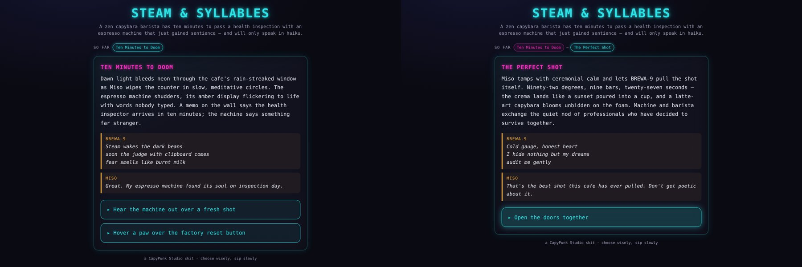

# CapyPunk Studio

A side feature of [CapyPunk](../README.md), with HarnessRouter as its agent backend. A visitor types a premise; an agent writes a short choose-your-own-adventure skit and ships it as files:

- `story/story.json`: 7 scenes, two decisions with two options each, branches that rejoin, a cliffhanger ending, characters with looks and voices, and one cinematic `shot` prompt per scene, so a story can be fed to the CapyPunk film pipeline later.
- `story/index.html`: a self-contained, playable version (no network requests), shown in a sandboxed preview.
- `story/manifest.json`: title, entry point, file list, summary, and whether the agent verified its links.

Visitors can revise a story with a follow-up, which continues the same HarnessRouter session.



## How it connects

```
browser ──► FastAPI (app.py) ──► HarnessRouter Cloud  POST /v1/responses  (background, polled)
   ▲              │                                    GET  /v1/responses/{id}
   └── signed, sandboxed previews and owner-checked downloads ◄── GET /v1/sessions/{id}/files, /content
```

- The browser talks only to `app.py`. The server reads `HR_API_KEY` from its environment or the gitignored, owner-only `.env.harnessrouter`; the key never reaches the browser, logs or git.
- One request is one task: `input` is what the visitor typed, `user` is the visitor's server-issued id, and `metadata.harness_id` is set by the server from `harnessrouter.json`, never from the browser.
- Follow-ups send `previous_response_id` and `metadata.session_id` of the task being revised; new premises start new tasks.
- Each task's response id and session id are stored with the visitor's own record (SQLite in `data/`, gitignored), so the page lists past stories and can continue them.
- Generated HTML is served from `/preview/<task>.<expiry>.<hmac>/...` with a `sandbox` CSP, only for allowlisted static types and paths inside `story/`. Downloads check that the visitor owns the task.

## The Harness

| | |
|---|---|
| Harness ID | `chrn_53247c83d5284e6a8bb6fc83084a9a3b` |
| Name | CapyPunk Studio |
| Base | `hermes` (HarnessRouter's recommended base for most jobs and for file deliverables) |
| Model | `qwen4-max` (Alibaba Qwen only, by the project owner's choice) |
| Workspace | Default Workspace |
| Memory | not sent: the service reports `memories: false` today |
| Budgets | 80 steps, 1200 s, $2 per task |

`harnessrouter.json` is the reviewed copy of the live setup and `instructions.md` holds the standing instructions. To change the Harness, edit them and run `python3 update_harness.py --apply`: it fetches the live Harness first (the live record wins if it was edited in the console), sends a full `PUT` with `If-Match`, and re-reads it.

## Run

```bash
cd studio
uv run --with-requirements requirements.txt uvicorn app:app --port 8770
uv run --with-requirements requirements.txt python -m unittest test_app   # 5 tests, fake HarnessRouter
```

Verified live through the app's own routes: the premise "A capybara barista discovers the cafe's espresso machine is a sentient AI that only speaks in haiku, and the health inspector arrives in ten minutes." produced "Steam & Syllables" in about four minutes (7 scenes, 2 decisions, no broken links, a working sandboxed preview), and a second visitor got 404 on its detail and download routes.
